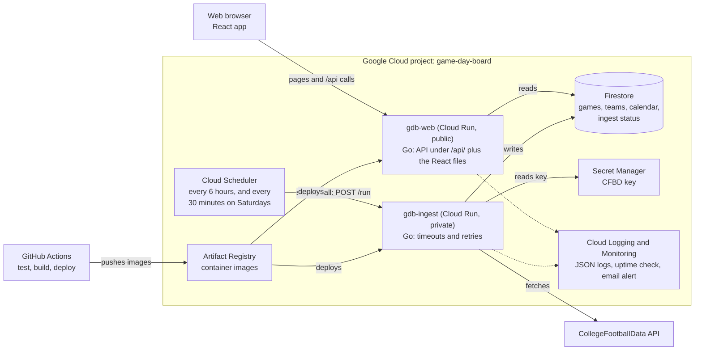

# Architecture

Visitors read the site's own copy of the data; only the ingest service talks to CollegeFootballData. The two paths never wait on each other.

## The two paths

**Read path.** The browser loads the React app from `gdb-web`. React then calls `/api/...` on the same service, which reads Firestore. Every response carries `lastUpdated`, the time of the last successful ingest, so the page always shows how old its data is.

**Ingest path.** Cloud Scheduler signs a call to the private `gdb-ingest` service. Cloud Run refuses any call without a valid signature from the scheduler's service account, so the code does not check it. Ingest reads the CFBD key from Secret Manager (as an environment variable), fetches data, keeps only games involving Big 12 and SEC teams, and saves them under their CFBD game ID, so a repeated run overwrites rather than duplicates.

## How few calls it makes

The CFBD free tier allows 1,000 calls a month.

| Run type | When | Calls |
| --- | --- | --- |
| Full refresh: calendar, teams for 2 conferences, regular and postseason games | First run, then once a week | 5 |
| Current week only | Every other run | 1 |

Schedule: every 6 hours (about 120 runs a month) plus every 30 minutes from noon to midnight Central time on Saturdays (about 100 more). That is roughly 240 calls a month, under a quarter of the quota. Every run records CFBD's own `X-CallLimit-Remaining` count in Firestore and in the logs.

## Availability features

| Feature | Where | Plain words |
| --- | --- | --- |
| Liveness `/api/health` | `api` | "Is the process running?" Checks nothing else, so a database blip never gets healthy instances restarted |
| Readiness `/api/ready` | `api` | "Can it do useful work?" Checks that Firestore answers |
| Timeouts | `cfbd` (10 seconds per attempt), `api` (5 seconds per database call), HTTP server | Nothing waits forever |
| Retries with backoff and jitter | `cfbd`, `retry` | Up to 3 retries on timeouts, 429, and 5xx, waiting longer each time, with randomness so many clients do not retry in step. Honors `Retry-After`. Never retries a 4xx that our own request caused |
| Serve the last good data | `ingest`, `api` | A failed ingest leaves stored data alone and records the error; the site keeps working and shows the data's age |
| Graceful shutdown | `httpx` | On SIGTERM, finish requests in progress before exiting |
| Structured logs with trace IDs | `httpx` | One JSON line per request; every line from one request shares a trace ID in Cloud Logging |
| Verified deploys | CI/CD | A new version gets no traffic until its health check passes |
| Scaling caps and a budget alert | Cloud Run, Billing | At most 2 instances of the site and 1 of ingest; email at 50, 90, and 100 percent of $5 a month |

## Change from the original design

The SRS (decision D6) planned Firebase Hosting for the React files, with `/api` routed to Cloud Run. Adding Firebase to a Google Cloud project needs a one-time step in the Firebase console, so the first version instead serves the React files from the same Cloud Run service as the API, the alternative D6 listed. It is one fewer product to run. Moving to Firebase Hosting later changes only the deploy step, not the code.

## Services and identities

| Identity (service account) | Used by | Permissions |
| --- | --- | --- |
| `gdb-api` | `gdb-web` | Read Firestore |
| `gdb-ingest` | `gdb-ingest` | Read and write Firestore; read the one secret |
| `gdb-scheduler` | Cloud Scheduler | Call `gdb-ingest` |
| `gdb-deployer` | GitHub Actions, through Workload Identity Federation | Deploy Cloud Run, push images, run as the two service identities above |

Each identity has only what its job needs (NFR-10), so a mistake or a compromise in one part cannot reach the rest.

## Runbook: when something goes wrong

| Symptom | First checks | Fix |
| --- | --- | --- |
| Email: "Game Day Board site is down" | Console: **Cloud Run → gdb-web → Logs** for errors; the latest run under the repository's **Actions** tab | If the latest deploy broke it: **Cloud Run → gdb-web → Revisions**, pick the previous revision, **Manage traffic**, send it 100 percent |
| Site up, but "Data updated" is many hours old | **Cloud Scheduler**: last run result; **Cloud Run → gdb-ingest → Logs**: lines with "ingest run failed" | Fix the cause (for example a revoked key: add a new version of the `cfbd-api-key` secret), then **Cloud Scheduler → gdb-ingest-regular → Force run** |
| Ingest logs show HTTP 401 from CollegeFootballData | The key is wrong or was revoked | Request a new key; `gcloud secrets versions add cfbd-api-key --data-file=-` with the key piped in, as in build guide step 1.4 |
| `callsRemaining` in the ingest logs is low | Something is calling more often than planned | Pause the Saturday job: **Cloud Scheduler → gdb-ingest-saturday → Pause** |
